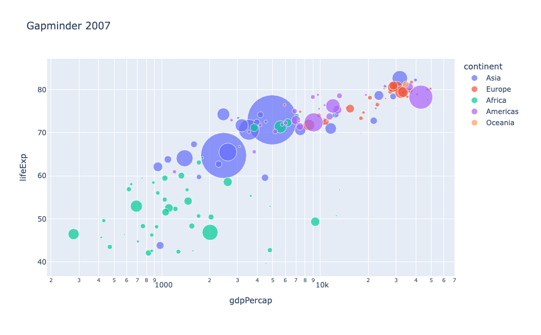
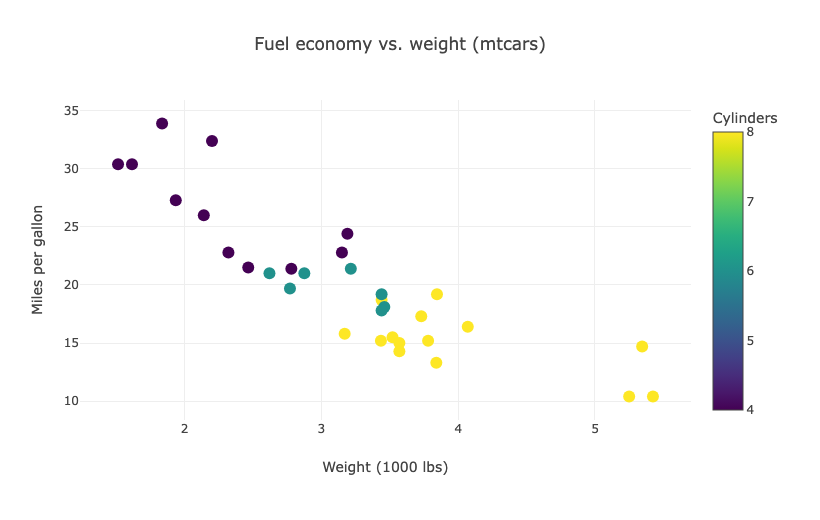
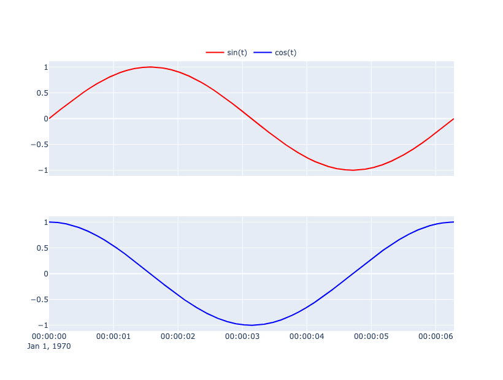

# plotly.R.core

Interactive web graphics for R, built on [plotly.js](https://github.com/plotly/plotly.js)
and following the design of the [plotly Python package](https://github.com/plotly/plotly.py).

- **Graph objects generated from the plotly.js schema.** All 47 trace types and
  every layout object have a `go_*()` constructor (`go_scatter()`,
  `go_bar_marker()`, `go_layout_xaxis()`, ... 979 in total) with documentation
  generated from the schema.
- **Validation.** Every property is checked when objects are created or
  modified, with plotly.py-style error messages and "Did you mean" suggestions.
- **Figures as values.** `go_figure()`, `add_<trace>()`, `update_layout()`,
  `update_traces()`, `update_xaxes()`, `add_annotation()` and friends return
  new figures, so they chain with the base R pipe `|>`.
- **Subplots.** `make_subplots()` is a port of plotly.py's, tested against its
  output; traces and layout objects are placed with `row`, `col` and
  `secondary_y`.
- **Plotly Express.** All 35 `px.*` functions plus `imshow` as `px_scatter()`,
  `px_line()`, `px_bar()`, `px_histogram()`, ... with faceting, marginals,
  trendlines, animation, the `px.data` datasets, `px.colors` palettes and
  templates. Output is tested against plotly.py on 72 cases.
- **Minimal dependencies.** data.table, htmlwidgets and jsonlite.

> **Status:** early development. Graph objects, figures, subplots, templates
> and Plotly Express are in place; Shiny, Quarto, compatibility with the
> legacy plotly package and static image export are still to come.

## Installation

```r
# From a local clone
install.packages("path/to/plotly.R.core", repos = NULL, type = "source")
```

## Example: Plotly Express

```r
library(plotly.R.core)

px_scatter(
  px_data_gapminder(year = 2007),
  x = "gdpPercap", y = "lifeExp", size = "pop", color = "continent",
  hover_name = "country", log_x = TRUE, size_max = 60, title = "Gapminder 2007"
)
```



Column arguments take column names, vectors, or one-sided formulas evaluated
in the data (`x = ~ log10(gdpPercap)`).

## Example: a 2D scatter plot with graph objects

```r
library(plotly.R.core)

fig <- go_figure() |>
  add_scatter(
    x = mtcars$wt,
    y = mtcars$mpg,
    mode = "markers",
    text = rownames(mtcars),
    marker = list(
      size = 12,
      color = mtcars$cyl,
      colorscale = "Viridis",
      showscale = TRUE,
      colorbar = list(title = "Cylinders")
    ),
    hovertemplate = "%{text}<br>Weight: %{x} (1000 lbs)<br>MPG: %{y}<extra></extra>"
  ) |>
  update_layout(title = "Fuel economy vs. weight (mtcars)") |>
  update_xaxes(title_text = "Weight (1000 lbs)") |>
  update_yaxes(title_text = "Miles per gallon")

fig
```



Printing a figure renders it in the RStudio viewer or a browser, and inline in
R Markdown and Quarto documents.

## Example: subplots

```r
fig <- make_subplots(
  rows = 2, cols = 2,
  specs = list(
    list(list(secondary_y = TRUE), list(type = "domain")),
    list(list(colspan = 2), NULL)
  ),
  subplot_titles = c("Scatter + secondary y", "Pie", "Bar across both columns")
) |>
  add_scatter(x = mtcars$wt, y = mtcars$mpg, mode = "markers", name = "mpg", row = 1, col = 1) |>
  add_scatter(x = sort(mtcars$wt), y = sort(mtcars$hp), mode = "lines", name = "hp",
              row = 1, col = 1, secondary_y = TRUE) |>
  add_pie(labels = c("4", "6", "8"), values = as.vector(table(mtcars$cyl)), row = 1, col = 2) |>
  add_bar(x = rownames(mtcars), y = mtcars$qsec, name = "qsec", row = 2, col = 1) |>
  update_yaxes(title_text = "hp", row = 1, col = 1, secondary_y = TRUE) |>
  update_layout(showlegend = FALSE)
```



## Graph objects and validation

Nested properties can also be written with "magic underscores", as in plotly.py:
`marker_size = 12` is the same as `marker = list(size = 12)`. Invalid values are
caught immediately:

```r
add_scatter(fig, x = mtcars$wt, y = mtcars$mpg, mode = "dots")
#> Error: Invalid value of type 'character' received for the 'mode' property of scatter
#>     Received value: "dots"
#>
#>     The 'mode' property is a flaglist and may be specified as a string containing:
#>       - Any combination of "lines", "markers", "text" joined with '+' characters (e.g. 'lines+markers')
#>         OR exactly one of "none"
```

## Development

Code generation follows plotly.py's `commands.py` and `codegen/`:

```sh
Rscript commands.R updateplotlyjs        # bundle the latest plotly.js from npm
Rscript commands.R codegen               # regenerate validators, go_*() constructors and figure functions
Rscript -e 'roxygen2::roxygenise()'      # rebuild documentation
R CMD build . && R CMD check --as-cran plotly.R.core_*.tar.gz
```

Generated files (`R/zz-gen-*.R`, `R/sysdata.rda`) are committed and must not be
edited by hand. Tests are plain R scripts in `tests/`.
