# Plotly R examples

These examples are adapted from the [Plotly R
documentation](https://plotly.com/r/), rewritten with plotly.core’s
graph objects:
[`go_figure()`](https://msummersgill.github.io/plotly.R.core/reference/go_figure.md),
`add_<trace>()`,
[`update_layout()`](https://msummersgill.github.io/plotly.R.core/reference/update_layout.md)
and the `go_*()` constructors.

## Fundamentals

[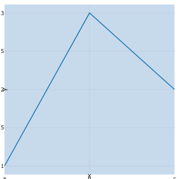The Figure Data
Structure](https://msummersgill.github.io/plotly.R.core/articles/r-docs/figure-structure.md)
[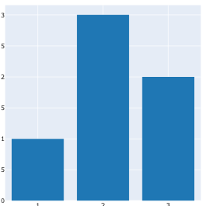Creating and Updating
Figures](https://msummersgill.github.io/plotly.R.core/articles/r-docs/creating-and-updating-figures.md)
[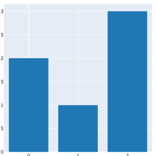Displaying
Figures](https://msummersgill.github.io/plotly.R.core/articles/r-docs/renderers.md)

Exporting Graphs as Static Images
[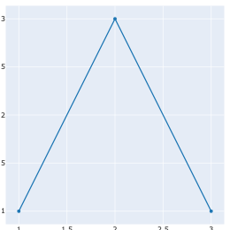Configuration](https://msummersgill.github.io/plotly.R.core/articles/r-docs/configuration-options.md)
[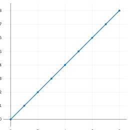Setting Graph
Size](https://msummersgill.github.io/plotly.R.core/articles/r-docs/setting-graph-size.md)
[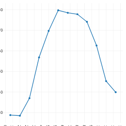Formatting
Ticks](https://msummersgill.github.io/plotly.R.core/articles/r-docs/tick-formatting.md)
[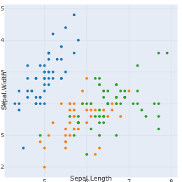Setting the Font, Title, Legend Entries,
and Axis
Titles](https://msummersgill.github.io/plotly.R.core/articles/r-docs/figure-labels.md)
[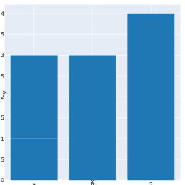Axes](https://msummersgill.github.io/plotly.R.core/articles/r-docs/axes.md)
[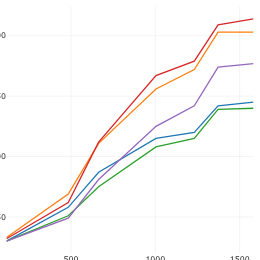Legends](https://msummersgill.github.io/plotly.R.core/articles/r-docs/legend.md)
[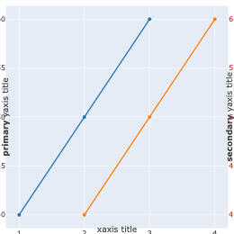Multiple
Axes](https://msummersgill.github.io/plotly.R.core/articles/r-docs/multiple-axes.md)
[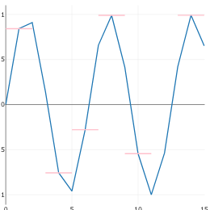Shapes](https://msummersgill.github.io/plotly.R.core/articles/r-docs/shapes.md)
[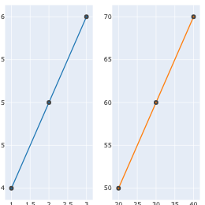Subplots](https://msummersgill.github.io/plotly.R.core/articles/r-docs/subplots.md)
[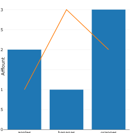Multiple Chart
Types](https://msummersgill.github.io/plotly.R.core/articles/r-docs/graphing-multiple-chart-types.md)
[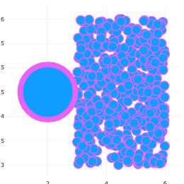Marker
Styling](https://msummersgill.github.io/plotly.R.core/articles/r-docs/marker-style.md)
[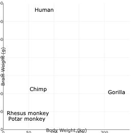Text and
Annotations](https://msummersgill.github.io/plotly.R.core/articles/r-docs/text-and-annotations.md)
[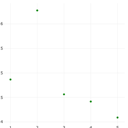Hover Text and
Formatting](https://msummersgill.github.io/plotly.R.core/articles/r-docs/hover-text-and-formatting.md)
[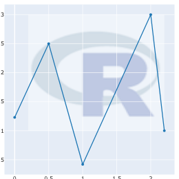Images](https://msummersgill.github.io/plotly.R.core/articles/r-docs/images.md)

Built-in Continuous Color Scales [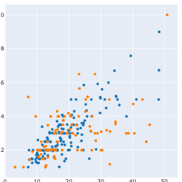Discrete
Colors](https://msummersgill.github.io/plotly.R.core/articles/r-docs/discrete-color.md)
[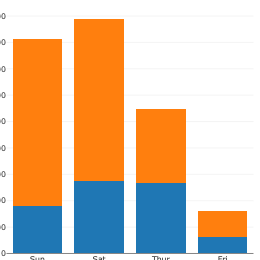Styling Plotly Figures in
R](https://msummersgill.github.io/plotly.R.core/articles/r-docs/styling-figures.md)
[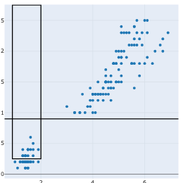Horizontal and Vertical Lines
and
Rectangles](https://msummersgill.github.io/plotly.R.core/articles/r-docs/horizontal-vertical-shapes.md)
[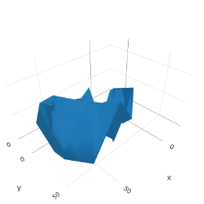3D
Axes](https://msummersgill.github.io/plotly.R.core/articles/r-docs/3d-axes.md)
[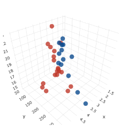3D Hover
Options](https://msummersgill.github.io/plotly.R.core/articles/r-docs/3d-hover.md)
[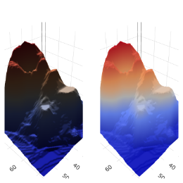3D Surface
Lighting](https://msummersgill.github.io/plotly.R.core/articles/r-docs/3d-surface-lighting.md)
[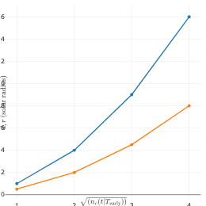LaTeX Typesetting in R
Graphs](https://msummersgill.github.io/plotly.R.core/articles/r-docs/latex.md)
[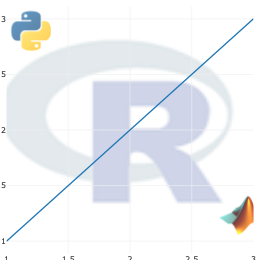Embedding Logos in Plotly
Graphs](https://msummersgill.github.io/plotly.R.core/articles/r-docs/logos.md)

Locales [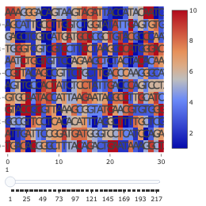WebGL Text and
Annotations](https://msummersgill.github.io/plotly.R.core/articles/r-docs/webgl-text-and-annotations.md)
[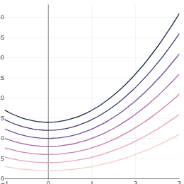Colorway](https://msummersgill.github.io/plotly.R.core/articles/r-docs/colorway.md)

Troubleshooting

## Basic Charts

[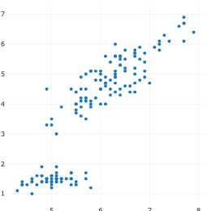Scatter and Line
Plots](https://msummersgill.github.io/plotly.R.core/articles/r-docs/line-and-scatter.md)
[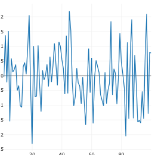Line
Plots](https://msummersgill.github.io/plotly.R.core/articles/r-docs/line-charts.md)
[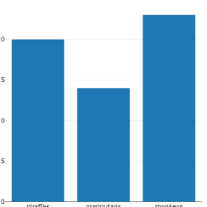Bar
Charts](https://msummersgill.github.io/plotly.R.core/articles/r-docs/bar-charts.md)
[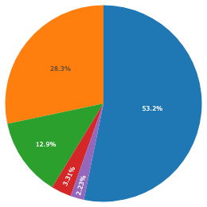Pie
Charts](https://msummersgill.github.io/plotly.R.core/articles/r-docs/pie-charts.md)
[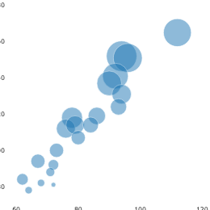Bubble
Charts](https://msummersgill.github.io/plotly.R.core/articles/r-docs/bubble-charts.md)

WebGL vs SVG in R

[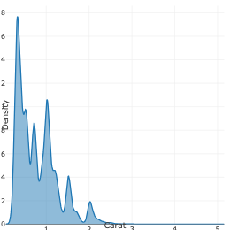Filled Area
Plots](https://msummersgill.github.io/plotly.R.core/articles/r-docs/filled-area-plots.md)
[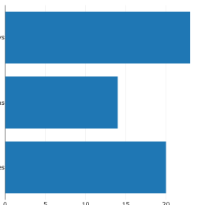Horizontal Bar
Charts](https://msummersgill.github.io/plotly.R.core/articles/r-docs/horizontal-bar-charts.md)
[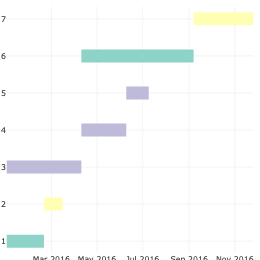Gantt
Charts](https://msummersgill.github.io/plotly.R.core/articles/r-docs/gantt.md)
[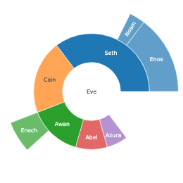Sunburst
Charts](https://msummersgill.github.io/plotly.R.core/articles/r-docs/sunburst-charts.md)
[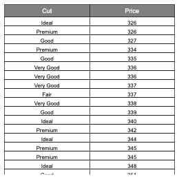Tables](https://msummersgill.github.io/plotly.R.core/articles/r-docs/table.md)
[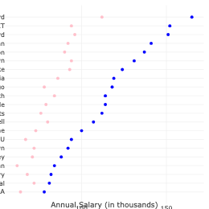Dot
Plots](https://msummersgill.github.io/plotly.R.core/articles/r-docs/dot-plots.md)
[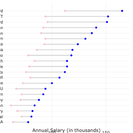Dumbbell
Plots](https://msummersgill.github.io/plotly.R.core/articles/r-docs/dumbbell-plots.md)
[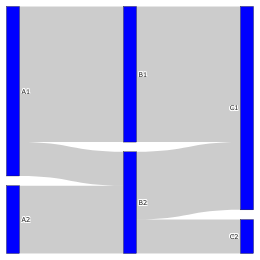Sankey
Diagram](https://msummersgill.github.io/plotly.R.core/articles/r-docs/sankey-diagram.md)
[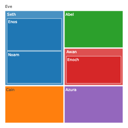Treemap
Charts](https://msummersgill.github.io/plotly.R.core/articles/r-docs/treemaps.md)

## Statistical Charts

[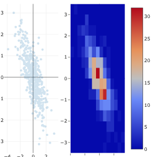2D
Histograms](https://msummersgill.github.io/plotly.R.core/articles/r-docs/2d-histogram.md)
[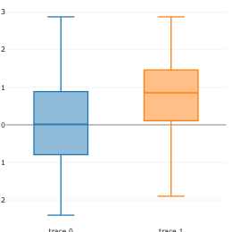Box
Plots](https://msummersgill.github.io/plotly.R.core/articles/r-docs/box-plots.md)
[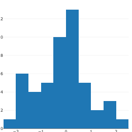Histograms](https://msummersgill.github.io/plotly.R.core/articles/r-docs/histograms.md)
[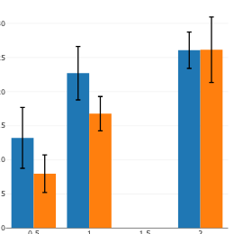Error
Bars](https://msummersgill.github.io/plotly.R.core/articles/r-docs/error-bars.md)
[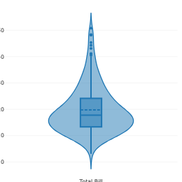Violin
Plots](https://msummersgill.github.io/plotly.R.core/articles/r-docs/violin.md)
[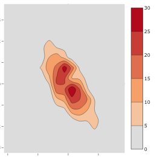2D Histogram
Contour](https://msummersgill.github.io/plotly.R.core/articles/r-docs/2d-histogram-contour.md)
[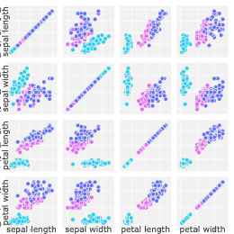Splom](https://msummersgill.github.io/plotly.R.core/articles/r-docs/splom.md)

Distplots

## Scientific Charts

[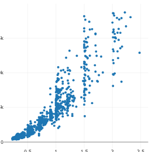Log
Plots](https://msummersgill.github.io/plotly.R.core/articles/r-docs/log-plot.md)
[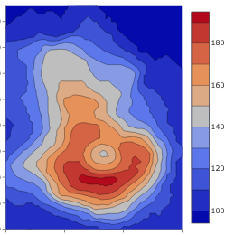Contour
Plots](https://msummersgill.github.io/plotly.R.core/articles/r-docs/contour-plots.md)
[Heatmaps](https://msummersgill.github.io/plotly.R.core/articles/r-docs/heatmaps.md)
[Network
Graph](https://msummersgill.github.io/plotly.R.core/articles/r-docs/network-graphs.md)
[Ternary Contour
Plot](https://msummersgill.github.io/plotly.R.core/articles/r-docs/ternary-contour.md)
[Parallel Coordinates
Plot](https://msummersgill.github.io/plotly.R.core/articles/r-docs/parallel-coordinates-plot.md)
[Carpet
Plot](https://msummersgill.github.io/plotly.R.core/articles/r-docs/carpet-plot.md)
[Carpet Scatter
Plot](https://msummersgill.github.io/plotly.R.core/articles/r-docs/carpet-scatter.md)
[Carpet Contour
Plot](https://msummersgill.github.io/plotly.R.core/articles/r-docs/carpet-contour.md)
[Polar
Charts](https://msummersgill.github.io/plotly.R.core/articles/r-docs/polar-chart.md)
[Radar
Charts](https://msummersgill.github.io/plotly.R.core/articles/r-docs/radar-chart.md)
[WebGL
Heatmaps](https://msummersgill.github.io/plotly.R.core/articles/r-docs/heatmap-webgl.md)
[Ternary
Plots](https://msummersgill.github.io/plotly.R.core/articles/r-docs/ternary-plots.md)
[Display Image
Data](https://msummersgill.github.io/plotly.R.core/articles/r-docs/displaying-images.md)

## Financial Charts

[Time Series and Date
Axes](https://msummersgill.github.io/plotly.R.core/articles/r-docs/time-series.md)
[Candlestick
Charts](https://msummersgill.github.io/plotly.R.core/articles/r-docs/candlestick-charts.md)
[OHLC
Charts](https://msummersgill.github.io/plotly.R.core/articles/r-docs/ohlc-charts.md)
[Waterfall
Charts](https://msummersgill.github.io/plotly.R.core/articles/r-docs/waterfall-charts.md)
[Funnel
Charts](https://msummersgill.github.io/plotly.R.core/articles/r-docs/funnel-charts.md)
[Gauge
Chart](https://msummersgill.github.io/plotly.R.core/articles/r-docs/gauge-charts.md)
[Bullet
Charts](https://msummersgill.github.io/plotly.R.core/articles/r-docs/bullet-charts.md)

## Maps

[Choropleth
Maps](https://msummersgill.github.io/plotly.R.core/articles/r-docs/choropleth-maps.md)
[Scatter Plots on
Maps](https://msummersgill.github.io/plotly.R.core/articles/r-docs/scatter-plots-on-maps.md)
[Mapbox
Density](https://msummersgill.github.io/plotly.R.core/articles/r-docs/mapbox-density-heatmaps.md)
[Lines on
Maps](https://msummersgill.github.io/plotly.R.core/articles/r-docs/lines-on-maps.md)
[Mapbox
Layers](https://msummersgill.github.io/plotly.R.core/articles/r-docs/mapbox-layers.md)
[Scattermapbox](https://msummersgill.github.io/plotly.R.core/articles/r-docs/scattermapbox.md)
[Mapbox Choropleth
Maps](https://msummersgill.github.io/plotly.R.core/articles/r-docs/mapbox-county-choropleth.md)
[Filled Area in
Mapbox](https://msummersgill.github.io/plotly.R.core/articles/r-docs/filled-area-on-mapbox.md)
[Lines on
Mapbox](https://msummersgill.github.io/plotly.R.core/articles/r-docs/lines-on-mapbox.md)
[Simple
Features](https://msummersgill.github.io/plotly.R.core/articles/r-docs/maps-sf.md)
[Bubble
Maps](https://msummersgill.github.io/plotly.R.core/articles/r-docs/bubble-maps.md)
[Map Configuration and
Styling](https://msummersgill.github.io/plotly.R.core/articles/r-docs/map-configuration.md)

## 3D Charts

[3D Scatter
Plots](https://msummersgill.github.io/plotly.R.core/articles/r-docs/3d-scatter-plots.md)
[3D Line
Plots](https://msummersgill.github.io/plotly.R.core/articles/r-docs/3d-line-plots.md)
[3D Surface
Plots](https://msummersgill.github.io/plotly.R.core/articles/r-docs/3d-surface-plots.md)
[3D Mesh
Plots](https://msummersgill.github.io/plotly.R.core/articles/r-docs/3d-mesh.md)
[3D Cone
Plots](https://msummersgill.github.io/plotly.R.core/articles/r-docs/cone-plot.md)
[3D Streamtube
Plots](https://msummersgill.github.io/plotly.R.core/articles/r-docs/streamtube-plot.md)
[3D Isosurface
Plots](https://msummersgill.github.io/plotly.R.core/articles/r-docs/3d-isosurface-plots.md)
[3D Tri-Surf
Plots](https://msummersgill.github.io/plotly.R.core/articles/r-docs/trisurf.md)

## Subplots and Multiple Axes

[Map Subplots And Small
Multiples](https://msummersgill.github.io/plotly.R.core/articles/r-docs/map-subplots-and-small-multiples.md)
[Inset
Plots](https://msummersgill.github.io/plotly.R.core/articles/r-docs/insets.md)
[3D
Subplots](https://msummersgill.github.io/plotly.R.core/articles/r-docs/3d-subplots.md)

## Artificial Intelligence and Machine Learning

[ML
Regression](https://msummersgill.github.io/plotly.R.core/articles/r-docs/ml-regression.md)
[kNN
Classification](https://msummersgill.github.io/plotly.R.core/articles/r-docs/knn-classification.md)
[ROC and PR
Curves](https://msummersgill.github.io/plotly.R.core/articles/r-docs/roc-and-pr-curves.md)
[PCA
Visualization](https://msummersgill.github.io/plotly.R.core/articles/r-docs/pca-visualization.md)
[t-SNE and UMAP
projections](https://msummersgill.github.io/plotly.R.core/articles/r-docs/t-sne-and-umap-projections.md)

## Controls

[Buttons](https://msummersgill.github.io/plotly.R.core/articles/r-docs/custom-buttons.md)
[Dropdown
Events](https://msummersgill.github.io/plotly.R.core/articles/r-docs/dropdowns.md)
[Range Sliders and
Selectors](https://msummersgill.github.io/plotly.R.core/articles/r-docs/range-slider.md)
[Sliders](https://msummersgill.github.io/plotly.R.core/articles/r-docs/sliders.md)

## Animations

[Intro to
Animations](https://msummersgill.github.io/plotly.R.core/articles/r-docs/animations.md)
[Cumulative
Animations](https://msummersgill.github.io/plotly.R.core/articles/r-docs/cumulative-animations.md)

## Advanced

[Plot CSV
Data](https://msummersgill.github.io/plotly.R.core/articles/r-docs/plot-data-from-csv.md)

## Transforms

[Filter](https://msummersgill.github.io/plotly.R.core/articles/r-docs/filter.md)
[Group
By](https://msummersgill.github.io/plotly.R.core/articles/r-docs/group-by.md)
[Aggregations](https://msummersgill.github.io/plotly.R.core/articles/r-docs/aggregations.md)

## Legacy Charts

[Polar Charts
\[legacy\]](https://msummersgill.github.io/plotly.R.core/articles/r-docs/legacy-polar-chart.md)

## Other

[Getting Started with
Plotly](https://msummersgill.github.io/plotly.R.core/articles/r-docs/getting-started.md)

GitHub for Data Scientists without the Terminal

[WebGL in Plotly and
R](https://msummersgill.github.io/plotly.R.core/articles/r-docs/webgl-vs-svg-million-points.md)
[WebGL in Plotly and
R](https://msummersgill.github.io/plotly.R.core/articles/r-docs/webgl-vs-svg-time-series.md)
