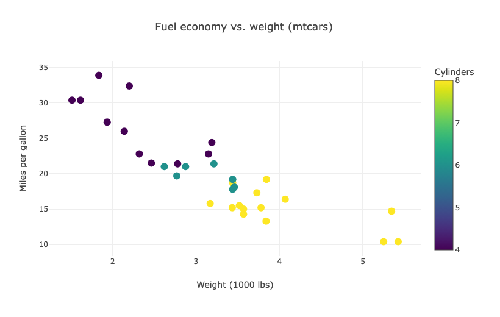

# plotly.core

Interactive web graphics for R built on
[plotly.js](https://github.com/plotly/plotly.js). plotly.core is a
rendering engine for the [plotly R
package](https://github.com/plotly/plotly.R) and can also be used
stand-alone.

- **Faster plots, less browser memory** plotly.core leverages advances
  in plotly.js to improve browser rendering performance, and implements
  optimizations to on the R backend to cut down plot generation time and
  size in memory. Rendering large time series plots and heatmaps is
  10-100x faster. DateTime optimizations and support for single
  precision floats allows up to 2x reduction of browser memory. *(See
  the render-performance vignette for more details)*
- **Machine-generated code and documentation from the plotly.js
  schema.** All 47 trace types and every layout object have a
  machine-generated `go_*()` constructor
  *([`go_scatter()`](https://msummersgill.github.io/plotly.R.core/reference/go_scatter.md),[`go_layout_xaxis()`](https://msummersgill.github.io/plotly.R.core/reference/go_layout_xaxis.md),
  … 979 in total)* and comprehensive R documentation of arguments and
  thorough validation generated from the schema. Future changes to the
  plotly.js schema can be ported to the R implementation without
  hand-writing any R code or documentation.
- **Full backwards compatibility with the plotly R package.** plotly’s
  `plot_ly()` and `ggplotly()` plots are rendered by plotly.core, so
  existing plotly R code gets the same performance work and plotly.js
  version. *([Working branch:
  msummersgill/plotly@plotly-core-render](https://github.com/msummersgill/plotly/tree/plotly-core-render))*
  Helper functions in the plotly package back-port functionality for
  features and behavior deprecated between the last CRAN release
  plotly.js/2.25.2 and plotly-js/latest
- **Shiny, R Markdown, Quarto, and static image export**
  [`plotlyOutput()`](https://msummersgill.github.io/plotly.R.core/reference/plotlyOutput.md)/[`renderPlotly()`](https://msummersgill.github.io/plotly.R.core/reference/plotlyOutput.md),
  [`event_data()`](https://msummersgill.github.io/plotly.R.core/reference/event_data.md)
  and
  [`plotlyProxy()`](https://msummersgill.github.io/plotly.R.core/reference/plotlyProxy.md)
  work as in the plotly R package; figures render inline in documents,
  as static images in PDF/Word
  output.[`save_image()`](https://msummersgill.github.io/plotly.R.core/reference/save_image.md)
  exports PNG, JPEG, WebP, SVG, PDF and EPS with headless Chrome (no
  Python needed).
- **Plotly Express** Ports of functionality from the plotly.py package
  introduce high-level methods quickly create figures with minimal code.

## Installation

plotly.core has not been submitted to CRAN yet. Install the development
version from GitHub with remotes.

``` r

# install.packages("remotes")
# plotly.core
remotes::install_github("msummersgill/plotly.R.core")
# plotly with plotly.core rendering
remotes::install_github("msummersgill/plotly@plotly-core-render")
```

## Example: Plotly Express

``` r

library(plotly.core)

px_data_gapminder(year = 2007) |>
  px_scatter(
    x = ~gdpPercap, y = ~lifeExp, size = ~pop, color = ~continent,
    hover_name = ~country, log_x = TRUE, size_max = 60, title = "Gapminder 2007"
  )
```


## Example: a 2D scatter plot with graph objects

``` r

library(plotly.core)

mtcars |>
  go_figure() |>
  add_scatter(
    x = ~wt,
    y = ~mpg,
    mode = "markers",
    text = rownames(mtcars),
    marker = list(
      size = 12,
      color = ~cyl,
      colorscale = "Viridis",
      showscale = TRUE,
      colorbar = list(title = "Cylinders")
    ),
    hovertemplate = "%{text}<br>Weight: %{x} (1000 lbs)<br>MPG: %{y}<extra></extra>"
  ) |>
  update_layout(title = "Fuel economy vs. weight (mtcars)") |>
  update_xaxes(title_text = "Weight (1000 lbs)") |>
  update_yaxes(title_text = "Miles per gallon")
```



## Example: subplots

``` r

fig <- make_subplots(
  rows = 2, cols = 2,
  specs = list(
    list(list(secondary_y = TRUE), list(type = "domain")),
    list(list(colspan = 2), NULL)
  ),
  subplot_titles = c("Scatter + secondary y", "Pie", "Bar across both columns")
) |>
  add_scatter(x = mtcars$wt, y = mtcars$mpg, mode = "markers", name = "mpg", row = 1, col = 1) |>
  add_scatter(x = sort(mtcars$wt), y = sort(mtcars$hp), mode = "lines", name = "hp",
              row = 1, col = 1, secondary_y = TRUE) |>
  add_pie(labels = c("4", "6", "8"), values = as.vector(table(mtcars$cyl)), row = 1, col = 2) |>
  add_bar(x = rownames(mtcars), y = mtcars$qsec, name = "qsec", row = 2, col = 1) |>
  update_yaxes(title_text = "hp", row = 1, col = 1, secondary_y = TRUE) |>
  update_layout(showlegend = FALSE)
```


A 2x2 subplot grid with a scatter plot and secondary y axis, a pie
chart, and a bar chart spanning the bottom row

## Graph objects and validation

Nested properties can also be written with “magic underscores”, as in
plotly.py: `marker_size = 12` is the same as `marker = list(size = 12)`.
Invalid values are caught immediately:

``` r

add_scatter(fig, x = mtcars$wt, y = mtcars$mpg, mode = "dots")
#> Error: Invalid value of type 'character' received for the 'mode' property of scatter
#>     Received value: "dots"
#>
#>     The 'mode' property is a flaglist and may be specified as a string containing:
#>       - Any combination of "lines", "markers", "text" joined with '+' characters (e.g. 'lines+markers')
#>         OR exactly one of "none"
```

## Shiny

``` r

library(shiny)
ui <- fluidPage(plotlyOutput("plot"), verbatimTextOutput("click"))
server <- function(input, output, session) {
  output$plot <- renderPlotly(px_data_iris() |> px_scatter(x = ~sepal_width, y = ~sepal_length))
  output$click <- renderPrint(event_data("plotly_click"))
}
shinyApp(ui, server)
```

[`plotlyProxy()`](https://msummersgill.github.io/plotly.R.core/reference/plotlyProxy.md)
and
[`plotlyProxyInvoke()`](https://msummersgill.github.io/plotly.R.core/reference/plotlyProxy.md)
update a rendered plot (e.g. `"extendTraces"`, `"relayout"`) without
redrawing it.

## Static images

``` r

# uses headless Chrome via chromote; offers to download Chrome Headless Shell
# if no browser is installed
save_image(fig, "figure.png", width = 800, height = 500, scale = 2)
save_image(fig, "figure.pdf")
save_image(fig, "figure.eps") # needs the rsvg package
```

In R Markdown and Quarto, figures in PDF or Word output are included as
static images automatically when Chrome is available.

## Existing plotly R code

The [plotly](https://github.com/plotly/plotly.R) package’s `plot_ly()`,
`add_*()`, [`layout()`](https://rdrr.io/r/graphics/layout.html),
`subplot()`,
[`highlight()`](https://msummersgill.github.io/plotly.R.core/reference/highlight.md)
and `ggplotly()` are built on plotly.core: plotly converts its plots to
plotly.core figures and renders them with plotly.core’s widget. The
extension points it uses are S3 generics here
([`add_trace()`](https://msummersgill.github.io/plotly.R.core/reference/add_traces.md),
the `add_<trace type>()` functions,
[`as_widget()`](https://msummersgill.github.io/plotly.R.core/reference/plotly_widget.md)
and
[`config()`](https://msummersgill.github.io/plotly.R.core/reference/config.md)),
plus
[`get_validator()`](https://msummersgill.github.io/plotly.R.core/reference/get_validator.md)
and
[`set_last_plot()`](https://msummersgill.github.io/plotly.R.core/reference/last_plot.md).

## Development

Code in this repository was generated by an LLM (Claude) directed to
follow the directory structure of plotly.py and test support and
backwards compatibility with the R plotly package. C code leverages
optimizations pioneered in
[`data.table::fwrite`](https://rdrr.io/pkg/data.table/man/fwrite.html)/[`data.table::fread`](https://rdrr.io/pkg/data.table/man/fread.html).
Authors of the “inspiration” code are included as contributors to this
package as such.

Code generation follows plotly.py’s `commands.py` and `codegen/`:

``` sh
Rscript commands.R updateplotlyjs        # bundle the latest plotly.js from npm
Rscript commands.R codegen               # regenerate validators, go_*() constructors and figure functions
Rscript -e 'roxygen2::roxygenise()'      # rebuild documentation
R CMD build . && R CMD check --as-cran plotly.core_*.tar.gz
```

Generated files (`R/zz-gen-*.R`, `R/sysdata.rda`) are committed and must
not be edited by hand. Tests are plain R scripts in `tests/`.
