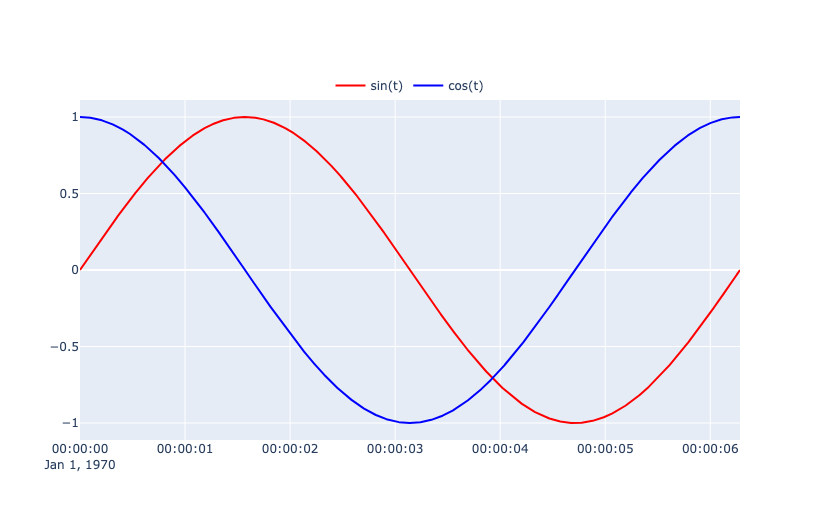
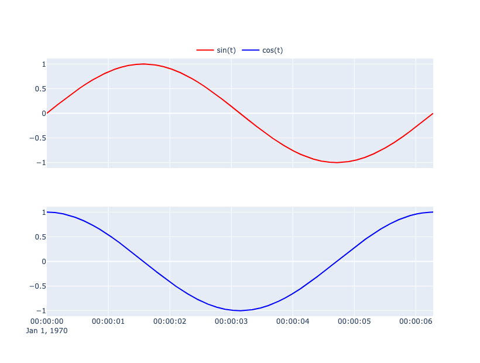
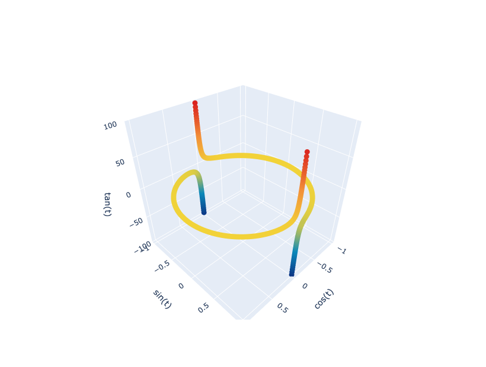

# plotly.core

Interactive web graphics for R built on
[plotly.js](https://github.com/plotly/plotly.js). plotly.core is a
rendering engine supporting the [plotly R
package](https://github.com/plotly/plotly.R) and experimental
[plotly.express R
package](https://github.com/msummersgill/plotly.R.express) and can also
be used stand-alone.

- **Faster plots, less browser memory** plotly.core leverages advances
  in plotly.js to improve browser rendering performance, and implements
  optimizations to on the R backend to cut down plot generation time and
  size in memory. Rendering large time series plots and heatmaps is
  10-100x faster. DateTime optimizations and support for single
  precision floats allows up to 2x reduction of browser memory. *(See
  the render-performance vignette for more details)*
- **Machine-generated code and documentation from the plotly.js
  schema.** Every object in the schema has a machine-generated `go_*()`
  constructor with exactly its properties: traces
  ([`go_scatter()`](https://msummersgill.github.io/plotly.R.core/reference/go_scatter.md)),
  the layout, objects shared across the schema
  ([`go_font()`](https://msummersgill.github.io/plotly.R.core/reference/go_font.md),
  [`go_colorbar()`](https://msummersgill.github.io/plotly.R.core/reference/go_colorbar.md),
  …) and every other nested object
  ([`go_scatter_marker()`](https://msummersgill.github.io/plotly.R.core/reference/go_scatter_marker.md),
  [`go_xaxis()`](https://msummersgill.github.io/plotly.R.core/reference/go_xaxis.md),
  [`go_sankey_link()`](https://msummersgill.github.io/plotly.R.core/reference/go_sankey_link.md),
  …), with comprehensive R documentation and thorough validation
  generated from the schema. Future changes to the plotly.js schema can
  be ported to the R implementation without hand-writing any R code or
  documentation.
- **Full backwards compatibility with the plotly R package.** plotly’s
  `plot_ly()` and `ggplotly()` plots are rendered by plotly.core, so
  existing plotly R code gets the same performance work and plotly.js
  version. *([Working branch:
  msummersgill/plotly@plotly-core-render](https://github.com/msummersgill/plotly/tree/plotly-core-render))*
  Helper functions in the plotly package back-port functionality for
  features and behavior deprecated between the last CRAN release
  plotly.js/2.25.2 and plotly-js/latest
- **Shiny, R Markdown, Quarto, and static image export**
  [`plotlyOutput()`](https://msummersgill.github.io/plotly.R.core/reference/plotlyOutput.md)/[`renderPlotly()`](https://msummersgill.github.io/plotly.R.core/reference/plotlyOutput.md),
  [`event_data()`](https://msummersgill.github.io/plotly.R.core/reference/event_data.md)
  and
  [`plotlyProxy()`](https://msummersgill.github.io/plotly.R.core/reference/plotlyProxy.md)
  work as in the plotly R package; figures render inline in documents,
  as static images in PDF/Word
  output.[`save_image()`](https://msummersgill.github.io/plotly.R.core/reference/save_image.md)
  exports PNG, JPEG, WebP, SVG, PDF and EPS with headless Chrome (no
  Python needed).

## Installation

plotly.core has not been submitted to CRAN yet. Install the development
version from GitHub with remotes.

``` r

# install.packages("remotes")
# plotly.core
remotes::install_github("msummersgill/plotly.R.core")
# plotly with plotly.core rendering
remotes::install_github("msummersgill/plotly@plotly-core-render")
```

## Graph Objects and Validation

Every object in the plotly.js schema has a corresponding `go_*()` S3
class and constructor with all supported properties.

- Each trace type and layout:
  [`go_scatter()`](https://msummersgill.github.io/plotly.R.core/reference/go_scatter.md),
  [`go_bar()`](https://msummersgill.github.io/plotly.R.core/reference/go_bar.md),
  …,
  [`go_layout()`](https://msummersgill.github.io/plotly.R.core/reference/go_layout.md);
- Line and Marker objects support different parameters for each trace
  type and get a dedicated constructor for each trace type:
  [`go_scatter_line()`](https://msummersgill.github.io/plotly.R.core/reference/go_scatter_line.md),[`go_scatter_marker()`](https://msummersgill.github.io/plotly.R.core/reference/go_scatter_marker.md),[`go_scatter_marker_line()`](https://msummersgill.github.io/plotly.R.core/reference/go_scatter_marker_line.md)
- Objects used in multiple trace types or layout objects have shared
  constructors:
  [`go_colorbar()`](https://msummersgill.github.io/plotly.R.core/reference/go_colorbar.md),
  `gofont`,
  [`go_scene_axis()`](https://msummersgill.github.io/plotly.R.core/reference/go_scene_axis.md)…
- Named lists work wherever a constructor does
  (`marker = list(size = 12)`).
- One-sided formulas such as `color = ~cyl` are kept by constructors and
  evaluated in the figure’s data when the trace is added:

``` r

mtcars |>
  go_figure() |>
  add_bar(
    x = ~factor(cyl), y = ~mpg,
    marker = go_bar_marker(color = ~hp, line = go_bar_marker_line(width = 1)),
    textfont = go_font(size = 14)
  ) |>
  update_layout(xaxis = go_xaxis(title = "Cylinders"))
```

Every property is checked against the plotly.js schema, so typos or
incorrect parameters are surfaced with informative error messages.

Unsupported value for a valid property lists supported options:

``` r

go_scatter(x = mtcars$wt, y = mtcars$mpg, mode = "dots")
#> Error: Invalid value of type 'character' received for the 'mode' property of scatter
#>     Received value: "dots"
#>
#>     The 'mode' property is a flaglist and may be specified as a string containing:
#>       - Any combination of "lines", "markers", "text" joined with '+' characters (e.g. 'lines+markers')
#>         OR exactly one of "none"
```

Wrong graph object provided gives a hint for the expected object:

``` r

go_bar(x = mtcars$cyl, y = mtcars$mpg, marker = go_font(size = 3))
#> Error: A go_font() object can't be used for bar.marker: use go_bar_marker()
```

Invalid property names throw an error with list of all the properties
supported by schema:

``` r

go_font(foo = "bar")
#> Error: Invalid property specified for go_font(): 'foo'
#> 
#>     Valid properties:
#>         color, family, lineposition, shadow, size, style, textcase, variant, weight
```

Invalid schema element in a legacy plotly methods drops invalid elements
and warns. *(Legacy plotly R rendered with no warning)*

``` r

plotly::plot_ly() |> 
  plotly::add_markers(x = 1, y = 1, mode = "markers", marker = list(foo = "bar"))
#> Warning message:
#> Invalid property specified for scatter.marker: 'foo'
#> 
#>     Valid properties:
#>         angle, angleref, autocolorscale, cauto, cmax, cmid, cmin, color, coloraxis, colorbar,
#>         colorscale, gradient, line, maxdisplayed, opacity, reversescale, showscale, size,
#>         sizemin, sizemode, sizeref, standoff, symbol
#> (invalid attributes are ignored) 
```

## Examples

Generate some data for plotting, store in a `data.table`. plotly.core
supports any data format that inherits `data.frame`, and trace values
can also be defined by vectors.

``` r

library(plotly.core)
library(data.table)

DT <- data.table(t = seq.POSIXt(from = as.POSIXct(0, tz = "UTC"),
                                to = as.POSIXct(2 * pi, tz = "UTC"),
                                length.out = 10000))
DT[, sin := sin(as.numeric(t))]
DT[, cos := cos(as.numeric(t))]
DT[, tan := tan(as.numeric(t))]
```

### Basic x-y plot

``` r

DT |>
  go_figure() |>
  add_scatter(x = ~t, y = ~sin, name = "sin(t)",
              mode = "lines", line = go_scatter_line(color = "red")) |>
  add_scatter(x = ~t, y = ~cos, name = "cos(t)",
              mode = "lines", line = go_scatter_line(color = "blue")) |>
  update_layout(legend = go_legend(orientation = "h",
                                   x = 0.5, xanchor = "center",
                                   y = 1, yanchor = "bottom"))
```



### Subplots with a shared Axis

``` r

make_subplots(rows = 2, shared_xaxes = TRUE) |>
  add_scatter(row = 1, col = 1,
              data = DT, x = ~ t, y = ~ sin, name = "sin(t)", 
              mode = "lines", line = go_scatter_line(color = "red")) |>
  add_scatter(row = 2, col = 1,
              data = DT, x = ~ t, y = ~ cos, name = "cos(t)", 
              mode = "lines", line = go_scatter_line(color = "blue")) |>
  update_layout(legend = go_legend(orientation = "h",
                                   x = 0.5, xanchor = "center",
                                   y = 1, yanchor = "bottom"))
```



### 3D scatter plot

``` r

DT |>
  go_figure() |>
  add_scatter3d(x = ~ cos, y = ~ sin, z = ~ tan,
                mode = "markers",
                marker = go_scatter3d_marker(size = 5,
                                             color = ~ tan,
                                             cmin = -100, cmax = 100,
                                             colorscale = "Portland")) |>
  update_scenes(xaxis = go_scene_axis(title = "cos(t)"),
                xaxis = go_scene_axis(title = "sin(t)"),
                zaxis = go_scene_axis(title = "tan(t)", range = c(-100, 100)))
```



## Shiny

``` r

library(shiny)
ui <- fluidPage(plotlyOutput("plot"), verbatimTextOutput("click"))
server <- function(input, output, session) {
  output$plot <- renderPlotly(
    iris |> go_figure() |> add_scatter(x = ~Sepal.Width, y = ~Sepal.Length, mode = "markers")
  )
  output$click <- renderPrint(event_data("plotly_click"))
}
shinyApp(ui, server)
```

[`plotlyProxy()`](https://msummersgill.github.io/plotly.R.core/reference/plotlyProxy.md)
and
[`plotlyProxyInvoke()`](https://msummersgill.github.io/plotly.R.core/reference/plotlyProxy.md)
update a rendered plot (e.g. `"extendTraces"`, `"relayout"`) without
redrawing it.

## Static images

``` r

# uses headless Chrome via chromote; offers to download Chrome Headless Shell
# if no browser is installed
save_image(fig, "figure.png", width = 800, height = 500, scale = 2)
save_image(fig, "figure.pdf")
save_image(fig, "figure.eps") # needs the rsvg package
```

In R Markdown and Quarto, figures in PDF or Word output are included as
static images automatically when Chrome is available.

## Existing plotly R code

The [plotly](https://github.com/plotly/plotly.R) package’s `plot_ly()`,
`add_*()`, [`layout()`](https://rdrr.io/r/graphics/layout.html),
`subplot()`,
[`highlight()`](https://msummersgill.github.io/plotly.R.core/reference/highlight.md)
and `ggplotly()` are built on plotly.core: plotly converts its plots to
plotly.core figures and renders them with plotly.core’s widget. The
extension points it uses are S3 generics here
([`add_trace()`](https://msummersgill.github.io/plotly.R.core/reference/add_traces.md),
the `add_<trace type>()` functions,
[`as_widget()`](https://msummersgill.github.io/plotly.R.core/reference/plotly_widget.md)
and
[`config()`](https://msummersgill.github.io/plotly.R.core/reference/config.md)),
plus
[`get_validator()`](https://msummersgill.github.io/plotly.R.core/reference/get_validator.md)
and
[`set_last_plot()`](https://msummersgill.github.io/plotly.R.core/reference/last_plot.md).

## Development

Code in this repository was generated by an LLM (Claude) directed to
follow the directory structure of plotly.py and test support and
backwards compatibility with the R plotly package. C code leverages
optimizations pioneered in
[`data.table::fwrite`](https://rdrr.io/pkg/data.table/man/fwrite.html)/[`data.table::fread`](https://rdrr.io/pkg/data.table/man/fread.html).
Authors of the “inspiration” code are included as contributors to this
package as such.

Code generation follows plotly.py’s `commands.py` and `codegen/`:

``` sh
Rscript commands.R updateplotlyjs        # bundle the latest plotly.js from npm
Rscript commands.R codegen               # regenerate validators, go_*() constructors and figure functions
Rscript -e 'roxygen2::roxygenise()'      # rebuild documentation
R CMD build . && R CMD check --as-cran plotly.core_*.tar.gz
```

Generated files (`R/zz-gen-*.R`, `R/sysdata.rda`) are committed and must
not be edited by hand. Tests are plain R scripts in `tests/`.
