These examples are adapted from the [Plotly R documentation](https://plotly.com/r/),
rewritten with plotly.core's graph objects: `go_figure()`, `add_<trace>()`,
`update_layout()` and the `go_*()` constructors.

## Fundamentals

```{=html}
<div class="r-docs-grid">
<a class="r-docs-card" href="figure-structure.html">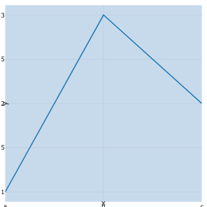<span>The Figure Data Structure</span></a>
<a class="r-docs-card" href="creating-and-updating-figures.html">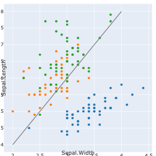<span>Creating and Updating Figures</span></a>
<a class="r-docs-card" href="renderers.html">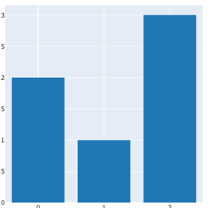<span>Displaying Figures</span></a>
<a class="r-docs-card" href="static-image-export.html"><span class="r-docs-nothumb"></span><span>Exporting Graphs as Static Images</span></a>
<a class="r-docs-card" href="configuration-options.html">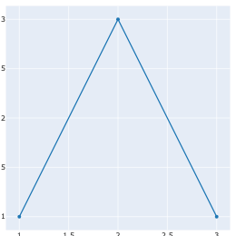<span>Configuration</span></a>
<a class="r-docs-card" href="setting-graph-size.html">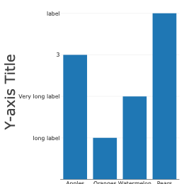<span>Setting Graph Size</span></a>
<a class="r-docs-card" href="tick-formatting.html">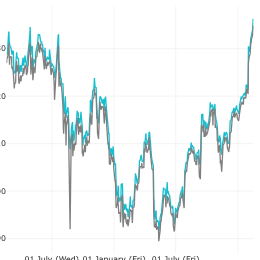<span>Formatting Ticks</span></a>
<a class="r-docs-card" href="figure-labels.html">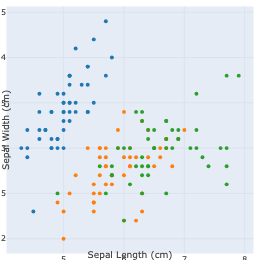<span>Setting the Font, Title, Legend Entries, and Axis Titles</span></a>
<a class="r-docs-card" href="axes.html">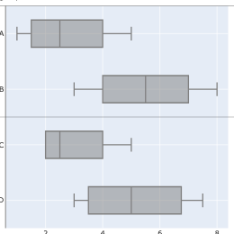<span>Axes</span></a>
<a class="r-docs-card" href="legend.html">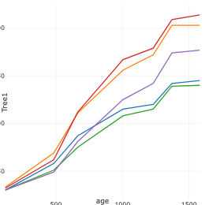<span>Legends</span></a>
<a class="r-docs-card" href="multiple-axes.html">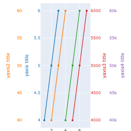<span>Multiple Axes</span></a>
<a class="r-docs-card" href="shapes.html">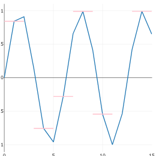<span>Shapes</span></a>
<a class="r-docs-card" href="subplots.html">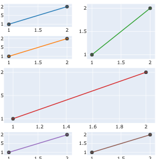<span>Subplots</span></a>
<a class="r-docs-card" href="graphing-multiple-chart-types.html">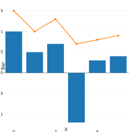<span>Multiple Chart Types</span></a>
<a class="r-docs-card" href="marker-style.html">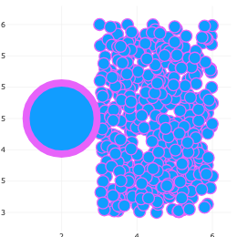<span>Marker Styling</span></a>
<a class="r-docs-card" href="text-and-annotations.html">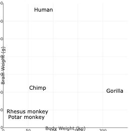<span>Text and Annotations</span></a>
<a class="r-docs-card" href="hover-text-and-formatting.html">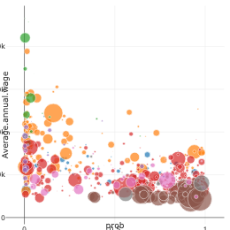<span>Hover Text and Formatting</span></a>
<a class="r-docs-card" href="images.html">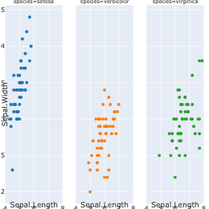<span>Images</span></a>
<a class="r-docs-card" href="builtin-colorscales.html"><span class="r-docs-nothumb"></span><span>Built-in Continuous Color Scales</span></a>
<a class="r-docs-card" href="discrete-color.html">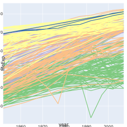<span>Discrete Colors</span></a>
<a class="r-docs-card" href="styling-figures.html">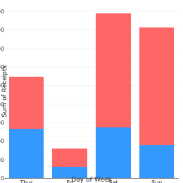<span>Styling Plotly Figures in R</span></a>
<a class="r-docs-card" href="horizontal-vertical-shapes.html">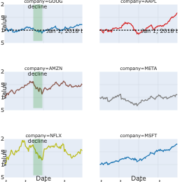<span>Horizontal and Vertical Lines and Rectangles</span></a>
<a class="r-docs-card" href="3d-axes.html">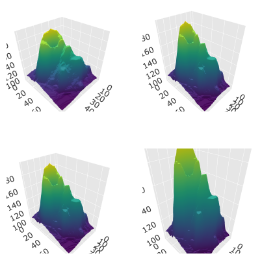<span>3D Axes</span></a>
<a class="r-docs-card" href="3d-hover.html">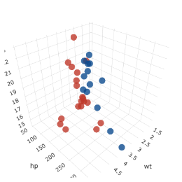<span>3D Hover Options</span></a>
<a class="r-docs-card" href="3d-surface-lighting.html">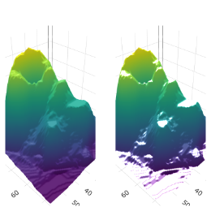<span>3D Surface Lighting</span></a>
<a class="r-docs-card" href="latex.html">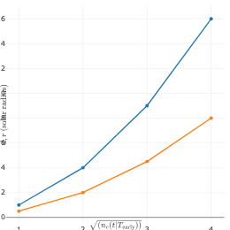<span>LaTeX Typesetting in R Graphs</span></a>
<a class="r-docs-card" href="logos.html">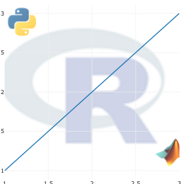<span>Embedding Logos in Plotly Graphs</span></a>
<a class="r-docs-card" href="locales.html"><span class="r-docs-nothumb"></span><span>Locales</span></a>
<a class="r-docs-card" href="webgl-text-and-annotations.html">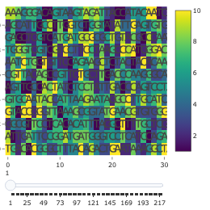<span>WebGL Text and Annotations</span></a>
<a class="r-docs-card" href="colorway.html">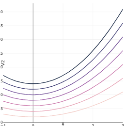<span>Colorway</span></a>
<a class="r-docs-card" href="troubleshooting.html"><span class="r-docs-nothumb"></span><span>Troubleshooting</span></a>
</div>
```

## Basic Charts

```{=html}
<div class="r-docs-grid">
<a class="r-docs-card" href="line-and-scatter.html">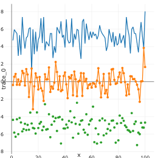<span>Scatter and Line Plots</span></a>
<a class="r-docs-card" href="line-charts.html">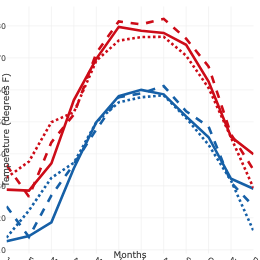<span>Line Plots</span></a>
<a class="r-docs-card" href="bar-charts.html">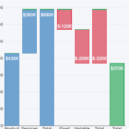<span>Bar Charts</span></a>
<a class="r-docs-card" href="pie-charts.html">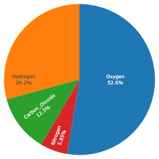<span>Pie Charts</span></a>
<a class="r-docs-card" href="bubble-charts.html">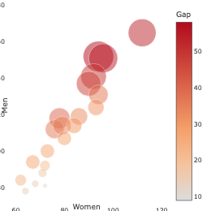<span>Bubble Charts</span></a>
<a class="r-docs-card" href="webgl-vs-svg.html"><span class="r-docs-nothumb"></span><span>WebGL vs SVG in R</span></a>
<a class="r-docs-card" href="filled-area-plots.html">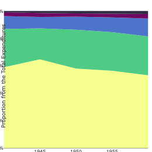<span>Filled Area Plots</span></a>
<a class="r-docs-card" href="horizontal-bar-charts.html">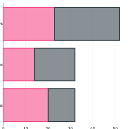<span>Horizontal Bar Charts</span></a>
<a class="r-docs-card" href="gantt.html">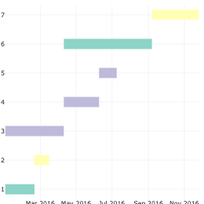<span>Gantt Charts</span></a>
<a class="r-docs-card" href="sunburst-charts.html">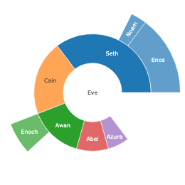<span>Sunburst Charts</span></a>
<a class="r-docs-card" href="table.html">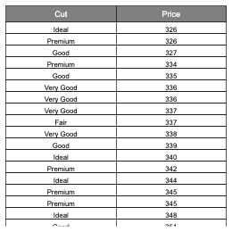<span>Tables</span></a>
<a class="r-docs-card" href="dot-plots.html">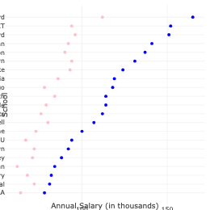<span>Dot Plots</span></a>
<a class="r-docs-card" href="dumbbell-plots.html">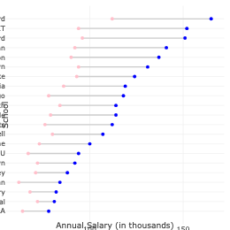<span>Dumbbell Plots</span></a>
<a class="r-docs-card" href="sankey-diagram.html">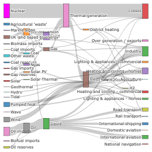<span>Sankey Diagram</span></a>
<a class="r-docs-card" href="treemaps.html">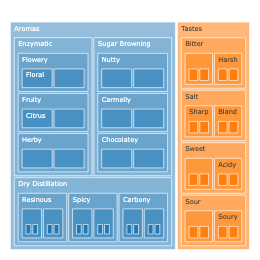<span>Treemap Charts</span></a>
</div>
```

## Statistical Charts

```{=html}
<div class="r-docs-grid">
<a class="r-docs-card" href="2d-histogram.html">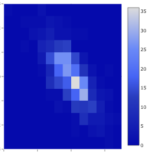<span>2D Histograms</span></a>
<a class="r-docs-card" href="box-plots.html">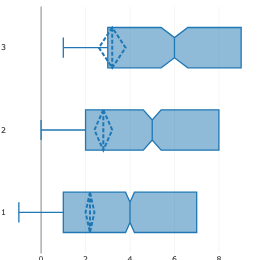<span>Box Plots</span></a>
<a class="r-docs-card" href="histograms.html">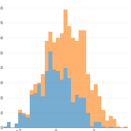<span>Histograms</span></a>
<a class="r-docs-card" href="error-bars.html">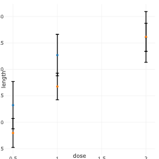<span>Error Bars</span></a>
<a class="r-docs-card" href="violin.html">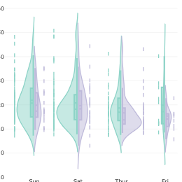<span>Violin Plots</span></a>
<a class="r-docs-card" href="2d-histogram-contour.html">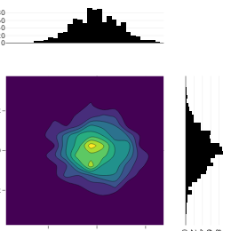<span>2D Histogram Contour</span></a>
<a class="r-docs-card" href="splom.html">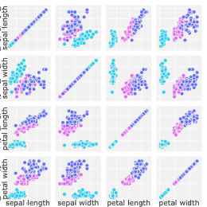<span>Splom</span></a>
<a class="r-docs-card" href="distplot.html"><span class="r-docs-nothumb"></span><span>Distplots</span></a>
</div>
```

## Scientific Charts

```{=html}
<div class="r-docs-grid">
<a class="r-docs-card" href="log-plot.html">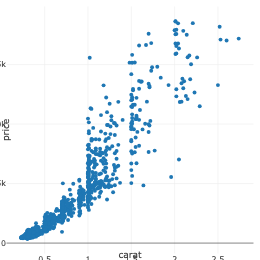<span>Log Plots</span></a>
<a class="r-docs-card" href="contour-plots.html">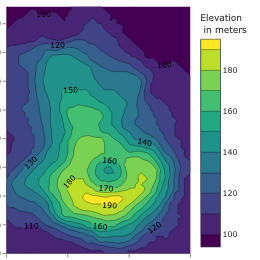<span>Contour Plots</span></a>
<a class="r-docs-card" href="heatmaps.html"><span>Heatmaps</span></a>
<a class="r-docs-card" href="network-graphs.html"><span>Network Graph</span></a>
<a class="r-docs-card" href="ternary-contour.html"><span>Ternary Contour Plot</span></a>
<a class="r-docs-card" href="parallel-coordinates-plot.html"><span>Parallel Coordinates Plot</span></a>
<a class="r-docs-card" href="carpet-plot.html"><span>Carpet Plot</span></a>
<a class="r-docs-card" href="carpet-scatter.html"><span>Carpet Scatter Plot</span></a>
<a class="r-docs-card" href="carpet-contour.html"><span>Carpet Contour Plot</span></a>
<a class="r-docs-card" href="polar-chart.html"><span>Polar Charts</span></a>
<a class="r-docs-card" href="radar-chart.html"><span>Radar Charts</span></a>
<a class="r-docs-card" href="heatmap-webgl.html"><span>WebGL Heatmaps</span></a>
<a class="r-docs-card" href="ternary-plots.html"><span>Ternary Plots</span></a>
<a class="r-docs-card" href="displaying-images.html"><span>Display Image Data</span></a>
</div>
```

## Financial Charts

```{=html}
<div class="r-docs-grid">
<a class="r-docs-card" href="time-series.html"><span>Time Series and Date Axes</span></a>
<a class="r-docs-card" href="candlestick-charts.html"><span>Candlestick Charts</span></a>
<a class="r-docs-card" href="ohlc-charts.html"><span>OHLC Charts</span></a>
<a class="r-docs-card" href="waterfall-charts.html"><span>Waterfall Charts</span></a>
<a class="r-docs-card" href="funnel-charts.html"><span>Funnel Charts</span></a>
<a class="r-docs-card" href="gauge-charts.html"><span>Gauge Chart</span></a>
<a class="r-docs-card" href="bullet-charts.html"><span>Bullet Charts</span></a>
</div>
```

## Maps

```{=html}
<div class="r-docs-grid">
<a class="r-docs-card" href="choropleth-maps.html"><span>Choropleth Maps</span></a>
<a class="r-docs-card" href="scatter-plots-on-maps.html"><span>Scatter Plots on Maps</span></a>
<a class="r-docs-card" href="mapbox-density-heatmaps.html"><span>Mapbox Density</span></a>
<a class="r-docs-card" href="lines-on-maps.html"><span>Lines on Maps</span></a>
<a class="r-docs-card" href="mapbox-layers.html"><span>Mapbox Layers</span></a>
<a class="r-docs-card" href="scattermapbox.html"><span>Scattermapbox</span></a>
<a class="r-docs-card" href="mapbox-county-choropleth.html"><span>Mapbox Choropleth Maps</span></a>
<a class="r-docs-card" href="filled-area-on-mapbox.html"><span>Filled Area in Mapbox</span></a>
<a class="r-docs-card" href="lines-on-mapbox.html"><span>Lines on Mapbox</span></a>
<a class="r-docs-card" href="maps-sf.html"><span>Simple Features</span></a>
<a class="r-docs-card" href="bubble-maps.html"><span>Bubble Maps</span></a>
<a class="r-docs-card" href="map-configuration.html"><span>Map Configuration and Styling</span></a>
</div>
```

## 3D Charts

```{=html}
<div class="r-docs-grid">
<a class="r-docs-card" href="3d-scatter-plots.html"><span>3D Scatter Plots</span></a>
<a class="r-docs-card" href="3d-line-plots.html"><span>3D Line Plots</span></a>
<a class="r-docs-card" href="3d-surface-plots.html"><span>3D Surface Plots</span></a>
<a class="r-docs-card" href="3d-mesh.html"><span>3D Mesh Plots</span></a>
<a class="r-docs-card" href="cone-plot.html"><span>3D Cone Plots</span></a>
<a class="r-docs-card" href="streamtube-plot.html"><span>3D Streamtube Plots</span></a>
<a class="r-docs-card" href="3d-isosurface-plots.html"><span>3D Isosurface Plots</span></a>
<a class="r-docs-card" href="trisurf.html"><span>3D Tri-Surf Plots</span></a>
</div>
```

## Subplots and Multiple Axes

```{=html}
<div class="r-docs-grid">
<a class="r-docs-card" href="map-subplots-and-small-multiples.html"><span>Map Subplots And Small Multiples</span></a>
<a class="r-docs-card" href="insets.html"><span>Inset Plots</span></a>
<a class="r-docs-card" href="3d-subplots.html"><span>3D Subplots</span></a>
</div>
```

## Artificial Intelligence and Machine Learning

```{=html}
<div class="r-docs-grid">
<a class="r-docs-card" href="ml-regression.html"><span>ML Regression</span></a>
<a class="r-docs-card" href="knn-classification.html"><span>kNN Classification</span></a>
<a class="r-docs-card" href="roc-and-pr-curves.html"><span>ROC and PR Curves</span></a>
<a class="r-docs-card" href="pca-visualization.html"><span>PCA Visualization</span></a>
<a class="r-docs-card" href="t-sne-and-umap-projections.html"><span>t-SNE and UMAP projections</span></a>
</div>
```

## Controls

```{=html}
<div class="r-docs-grid">
<a class="r-docs-card" href="custom-buttons.html"><span>Buttons</span></a>
<a class="r-docs-card" href="dropdowns.html"><span>Dropdown Events</span></a>
<a class="r-docs-card" href="range-slider.html"><span>Range Sliders and Selectors</span></a>
<a class="r-docs-card" href="sliders.html"><span>Sliders</span></a>
</div>
```

## Animations

```{=html}
<div class="r-docs-grid">
<a class="r-docs-card" href="animations.html"><span>Intro to Animations</span></a>
<a class="r-docs-card" href="cumulative-animations.html"><span>Cumulative Animations</span></a>
</div>
```

## Advanced

```{=html}
<div class="r-docs-grid">
<a class="r-docs-card" href="plot-data-from-csv.html"><span>Plot CSV Data</span></a>
</div>
```

## Transforms

```{=html}
<div class="r-docs-grid">
<a class="r-docs-card" href="filter.html"><span>Filter</span></a>
<a class="r-docs-card" href="group-by.html"><span>Group By</span></a>
<a class="r-docs-card" href="aggregations.html"><span>Aggregations</span></a>
</div>
```

## Legacy Charts

```{=html}
<div class="r-docs-grid">
<a class="r-docs-card" href="legacy-polar-chart.html"><span>Polar Charts [legacy]</span></a>
</div>
```

## Other

```{=html}
<div class="r-docs-grid">
<a class="r-docs-card" href="getting-started.html"><span>Getting Started with Plotly</span></a>
<a class="r-docs-card" href="webgl-vs-svg-million-points.html"><span>WebGL in Plotly and R</span></a>
<a class="r-docs-card" href="webgl-vs-svg-time-series.html"><span>WebGL in Plotly and R</span></a>
</div>
```

